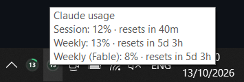
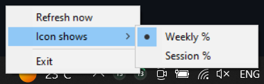

<div align="center">


# Claude Usage Widget

**Your Claude Code limits, living next to your clock.**

A tiny Windows tray app that shows your 5-hour session and weekly usage at a glance,<br>
so you never get surprised by a rate limit mid-flow again.


[](LICENSE)

</div>

---

## ✨ At a glance

| | State | Meaning |
|:---:|---|---|
|  | **Green** | Under 70%. Plenty of room, keep cooking. |
|  | **Amber** | 70–90%. Start pacing yourself. |
|  | **Red** | Over 90%. You're nearly at the wall. |
|  | **Grey ?** | No login found or the API is unreachable. |

The ring fills as you use more of your limit, and the number in the middle is the exact percentage.

<table align="center">
  <tr>
    <td align="center"></td>
    <td align="center"></td>
  </tr>
  <tr>
    <td align="center"><sub>Hover for details</sub></td>
    <td align="center"><sub>Right-click for options</sub></td>
  </tr>
</table>

- 🖱️ **Hover** to see a tooltip with session %, weekly %, per-model limits and reset countdowns (`resets in 2d 3h`)
- 🔔 **Get alerted** with a Windows notification when weekly usage crosses **85%**. It fires once per crossing and re-arms below 80%, so no spam.
- 🔀 **Right-click** to refresh now, switch the icon between weekly and session %, or exit

## 🚀 Quick start

```bash
pip install pystray pillow
pythonw claude_usage_widget.py
```

That's it. If Claude Code is installed and logged in, the icon shows up in your tray within a second or two.

> [!TIP]
> Windows likes to hide new tray icons. Click the `^` arrow by the clock and drag the icon onto the taskbar to pin it.

### Start with Windows

1. Press <kbd>Win</kbd>+<kbd>R</kbd>, type `shell:startup`, and press <kbd>Enter</kbd>
2. Right-click → **New → Shortcut**
3. Target: `pythonw C:\path\to\claude_usage_widget.py`

To undo, delete the shortcut.

See **[SETUP.md](SETUP.md)** for the full step-by-step guide.

## 🔒 Built to be trusted

This app reads your login token, so it was designed to be easy to audit:

| | |
|---|---|
| 📄 **One file** | About 350 lines of plain Python. You can read all of it in five minutes. |
| 👀 **Read-only credentials** | It reads the token from `%USERPROFILE%\.claude\.credentials.json` and never modifies the file. |
| 🧠 **Memory only** | The token is never logged, printed, written to disk or cached. |
| 🌐 **One destination** | It only talks to `api.anthropic.com` over certificate-verified HTTPS. |
| 🚫 **No funny business** | No admin rights, registry writes, auto-updates or telemetry. |
| 🐢 **Polite polling** | It checks every 5 minutes and backs off to 10 minutes after errors. |

No API key or extra account is needed. It reuses the login Claude Code already has.

## 🛠️ How it works

```
 ~/.claude/.credentials.json ──► read token (memory only)
                                       │
                                       ▼
            GET https://api.anthropic.com/api/oauth/usage
                                       │
                                       ▼
              parse session / weekly / per-model limits
                                       │
                                       ▼
     draw ring icon (Pillow) ──► tray + tooltip + alert (pystray)
                                       │
                                       └──── sleep 5 min, repeat
```

## ⚙️ Configuration

Tweak the constants at the top of `claude_usage_widget.py`:

| Constant | Default | What it does |
|---|---|---|
| `POLL_SECONDS` | `300` | How often to check usage |
| `ERROR_RETRY_SECONDS` | `600` | Back-off after an error or a 429 |
| `WARN_AT` / `CRIT_AT` | `70` / `90` | Amber and red thresholds (%) |
| `ALERT_AT` / `ALERT_CLEAR_AT` | `85` / `80` | When the notification fires and when it re-arms |

**Running Claude Code in WSL?** Point the widget at your Linux credentials file:

```bat
setx CLAUDE_CREDENTIALS_PATH "\\wsl$\Ubuntu\home\<you>\.claude\.credentials.json"
```

## 🩺 Troubleshooting

| Symptom | Fix |
|---|---|
| Grey `?` icon | Run `claude` and then `/login` once |
| "Token expired" | Open Claude Code once to refresh the login. The widget recovers on its next poll. |
| "Rate limited" | This happens occasionally. The widget backs off and retries on its own. |
| Icon not visible | Look under the `^` overflow arrow in the tray |

## 📋 Requirements

- Windows 10 or 11
- Python 3.10+
- [Claude Code](https://claude.com/claude-code) installed and logged in on a paid plan

## 📜 License

[MIT](LICENSE) © Ian Louw

---

<div align="center">
<sub>Not affiliated with Anthropic. Built for people who'd rather know their limits than find them.</sub>
</div>
